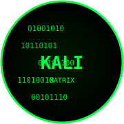

<div align="center">
  
</div>

# Script de compilación de Kali-Installer (versión compatible con Ubuntu)

_Constructor d'imáxenes ISO del instalador de Kali Linux, por mediación de `simple-cdd` (con `debian-cd`)._

Esti ye un fork/alteración de los [build-scripts orixinales de kali-installer](https://gitlab.com/kalilinux/build-scripts/kali-installer), adaptaos pa funcionar n'Ubuntu y otros sistemes basaos en Debian. El mesmu enfoque usa l'[equipu de Kali](https://www.kali.org/) pa xenerar les imáxenes base oficiales de Kali Linux, que s'atopen en [kali.org/get-kali/](https://www.kali.org/get-kali/).

Estes imáxenes puen usarse pa instalar Kali con varies personalizaciones mientres la configuración, dende CD/DVD/Blu-ray/USB/sdCard. Pa arrancar en mou live (p. ex. probar Kali ensin alterar nengún sistema operativu esistente), mira [kali-live](https://gitlab.com/kalilinux/build-scripts/kali-live).

_¡Construyi [el to Kali](https://www.kali.org/docs/introduction/kali-linux-image-overview/), güei!_

## Sincronización col upstream (payares de 2026)

Esti fork yá ta sincronizao colos [build-scripts orixinales de Kali](https://gitlab.com/kalilinux/build-scripts/kali-installer) y inclúi los últimos commits del upstream (`c2a7095`, `9a4e290`):

- **Kali Purple**: `kali-undercover` yá nun s'inclúi na ISO Purple (unos 10 MB aforraos). Añadióse a `simple-cdd/profiles/kali-purple.excludes`.
- **Kali Purple**: el repositoriu APT d'Elastic incluyíu pasó de `8.x` a `9.x` y anovóse la so clave de firma en `simple-cdd/profiles/kali-purple.postinst`. La fonte deb822 yá nun afita `Enabled: yes`.

Toes les carauterístiques d'esti fork compatibles con Ubuntu (soporte snap/flatpak, paquetes `.deb` locales, repositorios APT adicionales, salida `.img`/jigdo/zip y el comandu `build_ins_kali`) caltiénense intactes. Reconstruyi con `sudo ./build.sh -v purple` (o `sudo build_ins_kali -v purple`) pa llograr estos cambeos del upstream nuna ISO nueva.

## Espeyu del repositoriu y llanzamientos (payares de 2026)

El fork de GitHub ye'l repositoriu principal de desarrollu y caltiénse sincronizao col [espeyu de GitLab](https://gitlab.com/essential_repos/kali-installer-ubuver) en dambos sentíos:

- **GitHub → GitLab**: [`.github/workflows/sync-to-gitlab.yml`](./.github/workflows/sync-to-gitlab.yml) execútase en cada push a `main` y en cada etiqueta. Autentícase con una deploy key de GitLab con permisos d'escritura, guardada como'l secretu `GITLAB_DEPLOY_KEY` del repositoriu (SSH, asina que nun hai nengún token que caduque). Un grupu de concurrencia serializa les execuciones y namái s'envíen les etiquetes que falten o camudaron, polo que un push conxuntu de rama y etiqueta nun puede fallar con "tag already exists".
- **GitLab → GitHub**: un espeyu push nativu de GitLab usa una deploy key de GitHub con permisos d'escritura. Puyar refs idénticos nun fai nada, asina que les dos partes nun entren en bucle.

La configuración anterior con tokens HTTPS falló: faltaba'l secretu `GITLAB_TOKEN` y el PAT de GitLab guardáu en `origin` caducara. Dambos sentíos reconfiguráronse con deploy keys de ámbitu llindáu y verificáronse el 25 de payares de 2026; `main` y les etiquetes coinciden en dambos anfitriones.

Pues comprobar el espeyu en cualquier momentu:

```bash
git ls-remote github refs/heads/main
git ls-remote origin refs/heads/main
```

Los llanzamientos publíquense en GitHub con un `.zip` de códigu fonte y un `.deb` instalable qu'apurre `build_ins_kali`. El postrer llanzamientu ye [v1.2.9](https://github.com/BENDER35/kali-installer-ubuver/releases/tag/v1.2.9).

## Añadir paquetes .deb a la ISO (exemplu con Zoom)

Pues añadir paquetes `.deb` locales al instalador pa que s'incluyan na ISO y s'instalen mientres la instalación. Esto ye útil pa aplicaciones como Zoom, Chrome, etc.

Exemplu col paquete oficial de Zoom:

```bash
# Descargar el .deb oficial de Zoom
wget https://zoom.us/client/latest/zoom_amd64.deb -O zoom.deb

# Colocar el paquete en el directorio correcto para simple-cdd
cp zoom.deb simple-cdd/local_packages/

# Construir la ISO incluyendo ese paquete (se instalará automáticamente)
sudo build_ins_kali -v everything
```

O usando'l script directamente dende'l repositoriu:

```bash
cp zoom.deb simple-cdd/local_packages/
sudo ./build.sh -v everything
```

Tamién pues llistar dellos paquetes en `simple-cdd/local_packages/`. Éstos cópiense al repositoriu local del CD y instálense al traviés del perfil de simple-cdd.

**Nota:** Si usas el paquete `.deb` instalao (`build_ins_kali`), les ISOs guárdense en `~/isos_kali/` cuando l'executes ensin `sudo`, o en `/var/lib/kali-installer/output/` cuando l'executes con `sudo`.


Dempués d'instalar el paquete `.deb`, executa la ferramienta col comandu **`build_ins_kali`**:

Dempués d'instalar el paquete `.deb`, executa la ferramienta col comandu **`build_ins_kali`**:

```console
$ sudo dpkg -i kali-installer-ubuver.deb
$ build_ins_kali --help
$ sudo build_ins_kali -v everything -z
```

El instalador tamién va preguntar si quieres usar `~/isos_kali` como directoriu de salida mientres la instalación.

El instalador tamién va preguntar si quieres usar `~/isos_kali` como directoriu de salida mientres la instalación.

## Carauterístiques / Features

## Añadir un repositoriu APT esternu (con clave GPG) ya instalar paquetes

Pues añadir un repositoriu APT personalizao al sistema instalao, apurrir la so clave GPG y, opcionalmente, instalar paquetes d'él mientres el primer arranque (por mediación de `kali.postinst`).

Exemplu:

```bash
# Add a custom repo and install packages from it
sudo ./build.sh -v default \
  -r https://repo.example.com/debian \
  --repo-suite stable \
  --repo-comp main \
  --repo-key https://repo.example.com/repo.key \
  --repo-key-name repo-example.gpg \
  --repo-packages "mypackage anotherpackage"
```

Si la to clave ye un ficheru local, pues pasar la so ruta a `--repo-key` y cópiase automáticamente a la ISO:

```bash
sudo ./build.sh -v default -r https://repo.example.com/debian --repo-key ./myrepo.key --repo-packages "mypackage"
```

Opciones:
- `-r, --repo URL` - URL base del repositoriu
- `--repo-suite SUITE` - Suite/nome en códigu (por defectu: `kali-rolling`)
- `--repo-comp COMPONENTS` - Componentes (por defectu: `main`)
- `--repo-key FILE|URL` - Clave GPG (ficheru local o URL)
- `--repo-key-name NAME` - Nome del ficheru de clave (por defectu: `custom-repo.asc`)
- `--repo-packages PKGS` - Paquetes a instalar (separaos por espaciu o coma)

Usar `build_ins_kali` del paquete instalao funciona de la mesma manera.

- Funciona n'Ubuntu, Debian y otres distribuciones basaes en Debian
- Xenera imáxenes ISO estándar
- Salida opcional d'imaxe de discu `.img` cruda
- Soporte opcional pa jigdo (descargues distribuyíes)
- Crea ficheros ZIP comprimíos con tolos ficheros xeneraos
- Configurable por mediu d'opciones de línea de comandos y variables d'ambiente

## Requisitos previos

_Recomendamos compilar nun anfitrión basáu en Linux, que coincida cola arquitectura deseyada._

Hai varies formes de preparar l'ambiente pa usar el build-script de kali-installer. Pues escoyer ente:

- `build.sh` - [Compilar directamente na to máquina](#compilar-dende-lanfitrión-kali--ubuntu--basaos-en-debian)
- `build-in-container.sh` - [Compilar dende dientro d'un contenedor](#compilar-dende-dientro-dun-contenedor) _(como Docker o Podman)_ <!-- Should be able to use other alts, but they are untested -->

Pa que `build.sh` funcione, **riquiere accesu de superusuariu** (p. ex. sudo o un contenedor con root). Sicasí, KVM nun fai falta.

- - -

Primero instala git, y asegúrate de que'l repositoriu ta clonao localmente:

```console
$ sudo apt-get install --no-install-recommends \
    git ca-certificates
$ git clone https://gitlab.com/kalilinux/build-scripts/kali-installer.git
$ cd ./kali-installer/
```

### Compilar dende l'anfitrión (Kali / Ubuntu / basaos en Debian)

Pa compilar directamente nel to anfitrión, con `build.sh`, instala les dependencies de compilación:

```console
$ sudo apt-get install --no-install-recommends \
    simple-cdd debian-cd \
    cpio \
    mtools \
    dosfstools \
    xorriso \
    zip
```

- - -

Ahora yá puedes usar `./build.sh`, que va construyir una ISO del instalador de Kali directamente na to máquina.

### Compilar dende l'anfitrión (basaos en Debian, non Kali)

Si NON usas Kali como SO base, precisarás instalar el `kali-archive-keyring` de Kali pa que `simple-cdd` pueda baxar los paquetes de Kali.

```console
$ sudo apt-get install --no-install-recommends \
    wget ca-certificates
$ wget https://http.kali.org/pool/main/k/kali-archive-keyring/kali-archive-keyring_20YY.X_all.deb
$ sudo apt-get install ./kali-archive-keyring_*_all.deb
$ wget https://http.kali.org/pool/main/d/debian-cd/debian-cd_*_all.deb
$ sudo apt-get install ./debian-cd_*_all.deb
```
<!-- Alt: $ dpkg -i ./kali-archive-keyring_20YY.X_all.deb -->

_NOTA: Sustitúi `20YY.X` polos valores amosaos [equí, en `kali-archive-keyring`](https://http.kali.org/pool/main/k/kali-archive-keyring/)._

Según cuándo lo executes, pue que tamién precises una versión concreta de [simple-cdd](https://http.kali.org/kali/pool/main/s/simple-cdd/) _(Rastrexador de paquetes: [Debian](https://tracker.debian.org/pkg/simple-cdd)/[Kali](https://pkg.kali.org/pkg/simple-cdd))_ y/o [debian-cd](https://http.kali.org/kali/pool/main/d/debian-cd/) _(Rastrexador de paquetes: [Debian](https://tracker.debian.org/pkg/debian-cd)/[Kali](https://pkg.kali.org/pkg/debian-cd))_.
<!-- Alt: $ sudo apt-get satisfy --no-install-recommends debian-cd -->

- - -

Ahora yá puedes siguir [Compilar dende l'anfitrión (Kali)](#compilar-dende-lanfitrión-kali--ubuntu--basaos-en-debian) pa instalar les dependencies de compilación.

### Compilar dende dientro d'un contenedor

_Vamos saltanos la configuración del software de contenedores._

Si prefieres compilar dende dientro d'un contenedor, precisas instalar y configurar `docker` o `podman` na to máquina.

- `docker` rique que l'usuariu se añada al grupu de Docker, o usar la cuenta root (p. ex. `$ sudo ./build-in-container.sh`).
- `podman` probóse con root (p. ex. `$ sudo ./build-in-container.sh`), sicasí, el mou rootless nun ta soportao en diesen momentu.

- - -

`build-in-container.sh` ye un envoltoriu sobre `build.sh`. Detecta qué motor de contenedores compatible con OCI usar, encárgase de crear la [imaxe del contenedor](./Dockerfile) si falta, y arranca'l contenedor pa facer la compilación dende dientro.

Tienes tres formes d'apurrir la imaxe del contenedor:

```console
$ # Option #1 - Automated build (recommended)
$ ./build-in-container.sh
$ ./build-in-container.sh --force   # If you need to rebuild the image from scratch
$
$
$
$ # Option #2 - Manual build
$ docker build -t kali-build/kali-installer .
$ # ...OR...
$ podman build -t kali-build/kali-installer .
$
$
$
$ # Option #3 - Use the pre-generated
$ docker pull registry.gitlab.com/kalilinux/build-scripts/kali-installer:latest
$ docker tag registry.gitlab.com/kalilinux/build-scripts/kali-installer:latest kali-build/kali-installer
$ # ...OR...
$ podman pull registry.gitlab.com/kalilinux/build-scripts/kali-installer:latest
$ podman tag registry.gitlab.com/kalilinux/build-scripts/kali-installer:latest kali-build/kali-installer
$
$ # ...then point the build at it:
$ ./build-in-container.sh                                                                           # Locally built (automated or manual)
$ IMAGE=registry.gitlab.com/kalilinux/build-scripts/kali-installer:latest ./build-in-container.sh   # Pre-generated
```

- - -

Si tienes instalaos `docker` y `podman`, `build-in-container.sh` va usar `podman` por defectu. Pa cambiar esto, antepón `CONTAINER=docker` a `./build-in-container.sh`:

```console
$ CONTAINER=docker ./build-in-container.sh [...]
```

- - -

Ahora yá puedes usar `./build-in-container.sh` (en llugar de `./build.sh`) pa construyir una imaxe.

## Ayuda

```console
$ ./build.sh --help
Usage: build.sh [OPTIONS]

Build a Kali Linux Installer image.

Build options:
  -a, --arch ARCH              Build an image for this architecture (default: amd64)
                               Supported: amd64 arm64 armhf
  -b, --branch BRANCH          Kali branch used to build the image (default: kali-rolling)
                               Supported: kali-rolling kali-dev kali-last-snapshot
  -k, --keep                   Keep intermediary build artifacts
  -m, --mirror URL             Mirror used to build the image (default: http://http.kali.org/kali)
  -o, --output DIR             Output directory (default: /home/kali/kali-installer/output)
  -v, --variant VARIANT        Variant of image to build (default: default)
                               Supported: default everything netinst purple
  -x, --version VERSION        What to name the image release as (default: rolling)
  -j, --jigdo                  Generate jigdo files alongside ISO
  -z, --zip                    Create zip archive of the generated files
  -I, --img                    Also create a raw .img disk image (optional, disabled by default)
  -s, --snap                   Enable snap support (install snapd in target)
  -f, --flatpak                Enable flatpak support (install flatpak + Flathub in target)
      --snap-packages PKGS     Snap packages to install (comma/space separated; implies -s)
      --flatpak-packages PKGS  Flatpak packages to install (comma/space separated; implies -f)
  -h, --help                   Show this help and exit

Installer options:
  -H, --hostname HOSTNAME      Set system host name (default: kali)
  -P, --packages PKGS          Install extra packages (comma/space separated list)

Apt caching proxy:
  Auto-detected: localhost:3142 (apt-cacher-ng), localhost:8000 (squid-deb-proxy).
  If detected and http_proxy is not set, http_proxy is exported automatically.

Supported environment variables:
  http_proxy  HTTP proxy URL, see README.md for details
  DEBUG       Print extra debug output
  Any --flag value can be pre-set via its env var (e.g. ARCH, BUILD_MIRROR, OUT_DIR)

Examples:
  build.sh
  build.sh --branch kali-rolling
  build.sh -b kali-dev -v netinst -a arm64
```

_NOTA: Trés flags nun comparten el nome de la so variable: `--mirror` ye `BUILD_MIRROR`, `--hostname` ye `KALI_HOSTNAME` (bash yá define `HOSTNAME`) y `--output` ye `OUT_DIR`. Toos los demás flags son el so propiu nome, en mayúscules (p. ex. `--branch` ye `BRANCH`)._

<!-- _NOTE: Setting a "--flag" value as an environment variable only really works on the host (e.g. `./build.sh`). `build-in-container.sh` passes `OUT_DIR` through, plus its own `HOST_UID`/`HOST_GID`; every other variable you set is dropped._ -->

Pa más información y/o exemplos, mira:

- [kali.org/docs/development/live-build-a-custom-kali-iso/](https://www.kali.org/docs/development/live-build-a-custom-kali-iso/)
- [kali-preseed-examples](https://gitlab.com/kalilinux/recipes/kali-preseed-examples)
- [live-build-config-examples](https://gitlab.com/kalilinux/recipes/live-build-config-examples)
- [kali-live](https://gitlab.com/kalilinux/build-scripts/kali-live)

## Compilación + valores personalizaos

Usa `build.sh` o `build-in-container.sh`, a to gustu.
D'equí pa adelante usaremos `build.sh` por brevedá.

Les opciones por defectu construyirán una imaxe de [Kali rolling](https://www.kali.org/docs/general-use/kali-branches/), pa la arquitectura AMD64:

```console
$ sudo ./build.sh
┏━━(Kali Installer image)
┃  * Building a Kali Linux Installer image for amd64 architecture
┃ # System:
┃  * Build environment is host (bare metal)
┃  * Host architecture is amd64
┃ # Build:
┃  * Branch              : kali-rolling
┃  * Build mirror        : http://http.kali.org/kali/
┃  * Keep temporary files: false
┃  * Output              : /home/kali/kali-installer/output/kali-linux-rolling-installer-amd64-2026.4.2.iso
┃  * Variant             : default
┃  * Version             : rolling
┃ # Installer:
┃  * Additional packages :
┃  * Hostname            : kali
┃ # Proxy configuration:
┃  * No apt caching proxy detected
┗━━━━━━━━━━━━━━━━━━━━━━━━━━━━━━━━━━━━━━━━━
[...]
```

- - -

Construyi otra variante d'imaxe del instalador (`-v`/`--variant`), una con toles ferramientes o una instalación per rede:

```console
$ sudo ./build.sh --variant everything
$
$ sudo ./build.sh --variant netinst
```

- - -

Si quies depurar una execución fallida, pue ser útil caltener los artefactos intermedios de compilación darréu (`-k`/`--keep`), amás de baxar d'un [espeyu de Kali](https://www.kali.org/docs/community/kali-linux-mirrors/) concretu con `-m`/`--mirror`, cola mayor cantidá de salida posible (`DEBUG=1`):

```console
$ sudo DEBUG=1 ./build.sh --keep --mirror http://kali.download/kali
```

## Configuración del proxy de caché

Al construyir imáxenes del sistema operativu, ye útil tener un mecanismu de caché pa evitar baxar toos los paquetes d'Internet una y otra vez.
Pa eso, el script intenta detectar proxies de caché conocíos que puedan tar funcionando nel anfitrión local. Primero mira la configuración local d'APT `Acquire::http::Proxy`. Si nun ta definida, entós intenta detectar `apt-cacher-ng` y `squid-deb-proxy` comprobando si hai un serviciu escuchando nel so puertu por defectu. Esti mecanismu nun funciona con `approx` (un proxy de caché d'APT bien conocíu), porque s'arranca baxo demanda.

_NOTA: Esta detección namái s'executa cuando s'usa'l espeyu por defectu. Si pasas el to propiu valor `-m/--mirror`, la detección omítese._

Pa anular esta detección, puedes exportar tu mesmu la variable d'ambiente `http_proxy`.
Por exemplu, si quieres usar un proxy que funciona na to máquina nel puertu `9876`, usa: `export http_proxy=http://127.0.0.1:9876`.
Si quieres asegurarte de que nun s'usa nengún proxy, usa: `$ http_proxy= ./build.sh`.

Como alternativa, puedes montar un [espeyu local de Kali](https://www.kali.org/docs/community/setting-up-a-kali-linux-mirror/).

## Desplegar la imaxe del instalador

La `.iso` resultante ye una imaxe híbrida: pue escribise nuna unidá USB/sdCard, o grabase nun CD/DVD/Blu-ray, pa arrancar l'instalador de Kali.
Si prefieres probala ensin alterar nengún sistema operativu esistente, mira [kali-live](https://gitlab.com/kalilinux/build-scripts/kali-live).

### Grabar nuna unidá USB (dd)

```console
$ lsblk
$ sudo dd if=output/kali-linux-rolling-installer-amd64-2026.4.2.iso of=/dev/<usb-drive> bs=4M status=progress oflag=sync
```

_NOTA: Asegúrate d'usar el to dispositivu USB real, como `sdb` en llugar de `<usb-drive>`._

**CUIDÁU: ¡Esto va formatear la unidá USB y borrar tolo que tien!**

#### Dende Windows (balenaEtcher / Rufus)

Pues usar [balenaEtcher](https://etcher.balena.io/) o [Rufus](https://rufus.ie/) pa grabar la imaxe na unidá USB. Abre la ferramienta, selecciona'l ficheru d'imaxe, selecciona'l destín (la unidá USB) y graba.

### Executar en QEMU

Al ser una ISO híbrida, tamién pue executase direutamente con QEMU:

```console
$ sudo apt-get install --no-install-recommends \
    qemu-system-x86
$ qemu-system-x86_64 \
    -cdrom output/kali-linux-rolling-installer-amd64-2026.4.2.iso \
    -enable-kvm \
    -cpu host \
    -m 4096 \
    -smp cores=4
```

## Estructura

<!--
Sí, esto ye un envoltoriu d'un envoltoriu...

./build.sh -> simple-cdd -> debian-cd
-->

- `./build.sh` - el puntu d'entrada principal _(llama a `simple-cdd`, que dirixe `debian-cd`)_
- `./build-in-container.sh` - envuelve `./build.sh` dientro del ambiente de contenedor auxiliar _(usando [`./Dockerfile`](./Dockerfile))_
- `./Dockerfile` - el contenedor auxiliar de compilación
- `./kali-config/` - l'árbol de configuración de `debian-cd`: `common/` (compartío) más un directoriu `installer-*/` por variante _(`default`/`everything`/`netinst`/`purple`)_
- `./simple-cdd/` - la configuración del perfil de `simple-cdd` _(`profiles/`, `local_packages`, `disc-end-hook`, `simple-cdd.conf`)_

## Resumen de CI

El pipeline [`./.gitlab-ci.yml`](./.gitlab-ci.yml):

- **`lint`** - `shellcheck`/`yamllint`/`hadolint` sobre los scripts y el Dockerfile
- **`build_push_container`** - construyi'l contenedor auxiliar de compilación ([`./Dockerfile`](./Dockerfile)) y [publícalu](https://gitlab.com/kalilinux/build-scripts/kali-installer/container_registry)

El fluxu de trabayu [`./.github/workflows/sync-to-gitlab.yml`](./.github/workflows/sync-to-gitlab.yml) copia los push a `main` y les etiquetes al proyeutu de GitLab usando'l secretu `GITLAB_DEPLOY_KEY`. El espeyu push de GitLab unvia entós les mesmes refs de vuelta a GitHub. Mira [Espeyu del repositoriu y llanzamientos](#espeyu-del-repositoriu-y-llanzamientos-payares-de-2026).

## Limitaciones conocíes

Hai delles limitaciones conocíes al usar esti build-script:

- [Docker rootless](https://docs.docker.com/engine/security/rootless/) nun ta probao
- `podman` rootless nun ta soportao en diesen momentu, mira [Compilar dende dientro d'un contenedor](#compilar-dende-dientro-dun-contenedor)

_Si atopes daqué, [avísanos](https://gitlab.com/kalilinux/build-scripts/kali-installer/-/work_items)!_
