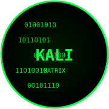

<div align="center">
  
</div>

# Script de Construcción de Instalador Kali (Versión Compatible con Ubuntu)

_Constructor de imágenes ISO del instalador de Kali Linux, vía `simple-cdd` (con `debian-cd`)._

Esta es una modificación del [script original de kali-installer](https://gitlab.com/kalilinux/build-scripts/kali-installer) adaptado para funcionar en Ubuntu y otras distribuciones basadas en Debian.

Estas imágenes pueden usarse para instalar Kali con varias personalizaciones durante la configuración, desde CD/DVD/Blu-ray/USB/tarjeta SD.

## Sincronización con el upstream (noviembre de 2026)

Este fork ya está sincronizado con el [script original de Kali](https://gitlab.com/kalilinux/build-scripts/kali-installer) e incluye los últimos commits del upstream (`c2a7095`, `9a4e290`):

- **Kali Purple**: ya no se incluye `kali-undercover` en la ISO Purple (ahorra unos 10 MB). Se añadió a `simple-cdd/profiles/kali-purple.excludes`.
- **Kali Purple**: el repositorio APT de Elastic incluido pasó de `8.x` a `9.x` y se actualizó su clave de firma en `simple-cdd/profiles/kali-purple.postinst`. La fuente deb822 ya no establece `Enabled: yes`.

Se conservan todas las mejoras de este fork para Ubuntu (soporte snap/flatpak, paquetes `.deb` locales, repositorios APT adicionales, salida `.img`/jigdo/zip y el comando `build_ins_kali`). Reconstruye con `sudo ./build.sh -v purple` (o `sudo build_ins_kali -v purple`) para obtener estos cambios del upstream en una nueva ISO.

## Añadir paquetes .deb al ISO (ejemplo con Zoom)

Es posible añadir paquetes `.deb` locales al instalador para que se incluyan en la ISO y se instalen automáticamente durante la instalación. Esto resulta útil para aplicaciones como Zoom, Google Chrome, etc.

Ejemplo con el paquete oficial de Zoom:

```bash
# Descargar el .deb oficial de Zoom
wget https://zoom.us/client/latest/zoom_amd64.deb -O zoom.deb

# Colocar el paquete en el directorio correspondiente
cp zoom.deb simple-cdd/local_packages/

# Construir la ISO incluyendo el paquete
sudo build_ins_kali -v everything
```

O directamente desde el repositorio:

```bash
cp zoom.deb simple-cdd/local_packages/
sudo ./build.sh -v everything
```

Todos los paquetes `.deb` que coloques en `simple-cdd/local_packages/` serán incluidos en el repositorio local del ISO e instalados mediante simple-cdd.

**Nota:** Si utilizas el paquete `.deb` instalado (`build_ins_kali`), las ISOs se guardarán en `~/isos_kali/` cuando se ejecute sin `sudo`, o en `/var/lib/kali-installer/output/` cuando se ejecute con `sudo`.

## Características

## Añadir un repositorio APT externo (con clave GPG) e instalar paquetes

Es posible añadir un repositorio APT personalizado al sistema instalado, proporcionar su clave GPG e instalar paquetes opcionales desde él durante el primer arranque (mediante `kali.postinst`).

Ejemplo:

```bash
# Añadir un repositorio externo e instalar paquetes
sudo ./build.sh -v default \
  -r https://repo.example.com/debian \
  --repo-suite stable \
  --repo-comp main \
  --repo-key https://repo.example.com/repo.key \
  --repo-key-name repo-example.gpg \
  --repo-packages "paquete1 paquete2"
```

Si la clave es un archivo local, se puede pasar su ruta a `--repo-key` y se copiará automáticamente al ISO:

```bash
sudo ./build.sh -v default -r https://repo.example.com/debian --repo-key ./mi-repo.key --repo-packages "paquete1"
```

Opciones:
- `-r, --repo URL` - URL base del repositorio
- `--repo-suite SUITE` - Suite/codename (por defecto: `kali-rolling`)
- `--repo-comp COMPONENTS` - Componentes (por defecto: `main`)
- `--repo-key FILE|URL` - Clave GPG (archivo local o URL)
- `--repo-key-name NAME` - Nombre del archivo de clave (por defecto: `custom-repo.asc`)
- `--repo-packages PKGS` - Paquetes a instalar (separados por espacio o coma)

También funciona con `build_ins_kali` del paquete instalado.

- Funciona en Ubuntu, Debian y otras distribuciones basadas en Debian
- Genera imágenes ISO estándar
- Salida opcional de imagen de disco `.img` cruda
- Soporte opcional para jigdo (descargas distribuidas)
- Crea archivos ZIP comprimidos con todos los archivos generados
- Configurable mediante opciones de línea de comandos y variables de entorno

## Requisitos Previos

Se recomienda construir en un host basado en Linux. Necesitarás acceso root (sudo).

### Clonar el repositorio

```console
$ sudo apt-get install --no-install-recommends git ca-certificates
$ git clone https://gitlab.com/essential_repos/kali-installer-ubuver.git
$ cd ./kali-installer-ubuver/
```

### Instalar dependencias

```console
$ sudo apt-get install --no-install-recommends \
    simple-cdd debian-cd \
    cpio \
    mtools \
    dosfstools \
    xorriso \
    zip
```

En sistemas que no son Kali (como Ubuntu), también puede necesitarse instalar `kali-archive-keyring`.

## Uso

### Instalar desde paquete Debian

```console
$ sudo dpkg -i kali-installer-ubuver.deb
$ build_ins_kali --help
$ sudo build_ins_kali -v everything -z
```

El instalador preguntará si desea usar `~/isos_kali` como directorio de salida.

### Ayuda

```console
$ ./build.sh --help
```

### Construcción básica

```console
$ sudo ./build.sh
```

### Opciones comunes

- `-v, --variant VARIANT`: Variante a construir (default, everything, netinst, purple)
- `-a, --arch ARCH`: Arquitectura (amd64, arm64, armhf)
- `-j, --jigdo`: Generar archivos jigdo junto con el ISO
- `-z, --zip`: Crear archivo ZIP con todos los archivos generados
- `-I, --img`: Generar imagen `.img` cruda (opcional, deshabilitado por defecto)
- `-s, --snap`: Habilitar soporte snap (instala snapd en el destino)
- `-f, --flatpak`: Habilitar soporte flatpak (instala flatpak + Flathub en el destino)
- `--snap-packages PKGS`: Paquetes snap a instalar (separados por coma/espacio; implica -s)
- `--flatpak-packages PKGS`: Paquetes flatpak a instalar (separados por coma/espacio; implica -f)
- `-k, --keep`: Mantener archivos temporales
- `-o, --output DIR`: Directorio de salida

### Ejemplos

```console
$ sudo ./build.sh --variant everything
$ sudo ./build.sh --variant netinst --jigdo
$ sudo ./build.sh -v default -z
$ sudo DEBUG=1 ./build.sh --keep
```

## ¿Qué es Jigdo?

Jigdo (Jigsaw Download) es un formato de descarga distribuida que permite reconstruir imágenes ISO a partir de archivos individuales descargados de mirrors. Esto reduce el espacio de almacenamiento y permite verificar integridad. Al usar `-j, --jigdo`, el script generará archivos `.jigdo`, `.template` y `.list.gz` junto con el ISO.

## Nombrado de la salida

El ISO generado conserva la versión de Kali donde estaba antes y añade el
número de versión instalado por la release después de la arquitectura
(ej. `kali-linux-rolling-installer-netinst-amd64-2026.4.2.iso`).

## Guía de Uso

Ver `GUIDE.md` para una explicación completa del funcionamiento en inglés y español.
