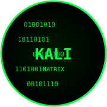

<div align="center">
  
</div>

# Kali-Installer Build-Script (Ubuntu Compatible Version / Versión Compatible con Ubuntu)

_Kali Linux installer ISO builder, via `simple-cdd` (with `debian-cd`)._

This is a fork/modification of the original [kali-installer build-scripts](https://gitlab.com/kalilinux/build-scripts/kali-installer) that has been adapted to work on Ubuntu and other Debian-based systems. The same approach is used by the [Kali team](https://www.kali.org/) to generate official Kali Linux base images, found on [kali.org/get-kali/](https://www.kali.org/get-kali/).

These images can be used to install Kali with various customization during setup, from a CD/DVD/Blu-ray/USB/sdCard. For live boot (e.g. try Kali out without altering any existing operating system), see [kali-live](https://gitlab.com/kalilinux/build-scripts/kali-live).

_Build [your Kali](https://www.kali.org/docs/introduction/kali-linux-image-overview/), today!_

## Upstream sync (November 2026)

This fork is now in sync with the original [Kali build-scripts](https://gitlab.com/kalilinux/build-scripts/kali-installer) and includes the latest upstream commits (`c2a7095`, `9a4e290`):

- **Kali Purple**: `kali-undercover` is no longer shipped in the Purple ISO (about 10 MB saved). It was added to `simple-cdd/profiles/kali-purple.excludes`.
- **Kali Purple**: the bundled Elastic APT repository moved from `8.x` to `9.x` and its signing key was refreshed in `simple-cdd/profiles/kali-purple.postinst`. The deb822 source no longer sets `Enabled: yes`.

All Ubuntu-compatible features of this fork (snap/flatpak support, local `.deb` packages, extra APT repositories, `.img`/jigdo/zip output and the `build_ins_kali` command) remain intact. Rebuild with `sudo ./build.sh -v purple` (or `sudo build_ins_kali -v purple`) to get these upstream changes in a new ISO.

## Repository mirror and releases (November 2026)

The GitHub fork is the primary development repository and is kept in sync with the [GitLab mirror](https://gitlab.com/essential_repos/kali-installer-ubuver) in both directions:

- **GitHub → GitLab**: [`.github/workflows/sync-to-gitlab.yml`](./.github/workflows/sync-to-gitlab.yml) runs on every push to `main` and on every tag. It authenticates with a write-enabled GitLab deploy key stored as the `GITLAB_DEPLOY_KEY` repository secret (SSH, so there is no token to expire). A concurrency group serializes runs and only missing or changed tags are pushed, so a combined branch/tag push cannot fail with "tag already exists".
- **GitLab → GitHub**: a native GitLab push mirror uses a write-enabled GitHub deploy key. Pushing identical refs is a no-op, so the two halves do not loop.

The previous HTTPS-token setup failed: the `GITLAB_TOKEN` secret was missing and the GitLab PAT stored in `origin` had expired. Both directions were reconfigured with scoped deploy keys and verified on 25 November 2026; `main` and the tags match on both hosts.

You can check the mirror at any time:

```bash
git ls-remote github refs/heads/main
git ls-remote origin refs/heads/main
```

Releases are published on GitHub with a source `.zip` and an installable `.deb` that provides `build_ins_kali`. The latest release is [v1.2.9](https://github.com/BENDER35/kali-installer-ubuver/releases/tag/v1.2.9).

## Adding .deb packages to the ISO (ejemplo con Zoom)

Puedes añadir paquetes `.deb` locales al instalador para que se incluyan en la ISO y se instalen durante la instalación. Esto es útil para aplicaciones como Zoom, Chrome, etc.

Ejemplo con el paquete oficial de Zoom:

```bash
# Descargar el .deb oficial de Zoom
wget https://zoom.us/client/latest/zoom_amd64.deb -O zoom.deb

# Colocar el paquete en el directorio correcto para simple-cdd
cp zoom.deb simple-cdd/local_packages/

# Construir la ISO incluyendo ese paquete (se instalará automáticamente)
sudo build_ins_kali -v everything
```

O usando el script directamente desde el repositorio:

```bash
cp zoom.deb simple-cdd/local_packages/
sudo ./build.sh -v everything
```

También puedes listar varios paquetes en `simple-cdd/local_packages/`. Estos se copian al repositorio local del CD y se instalan mediante el perfil de simple-cdd.

**Nota:** Si usas el paquete `.deb` instalado (`build_ins_kali`), los ISOs se guardarán en `~/isos_kali/` cuando lo ejecutes sin `sudo`, o en `/var/lib/kali-installer/output/` cuando lo ejecutes con `sudo`.


After installing the `.deb` package, run the tool with the **`build_ins_kali`** command:

Después de instalar el paquete `.deb`, ejecuta la herramienta con el comando **`build_ins_kali`**:

```console
$ sudo dpkg -i kali-installer-ubuver.deb
$ build_ins_kali --help
$ sudo build_ins_kali -v everything -z
```

The installer will also ask if you want to use `~/isos_kali` as the output directory during installation.

El instalador también preguntará si desea usar `~/isos_kali` como directorio de salida durante la instalación.

## Features / Características

## Adding an external APT repository (with GPG key) and installing packages

You can add a custom APT repository to the installed system, provide its GPG key and optionally install packages from it during first boot (via `kali.postinst`).

Example:

```bash
# Add a custom repo and install packages from it
sudo ./build.sh -v default \
  -r https://repo.example.com/debian \
  --repo-suite stable \
  --repo-comp main \
  --repo-key https://repo.example.com/repo.key \
  --repo-key-name repo-example.gpg \
  --repo-packages "mypackage anotherpackage"
```

If your key is a local file, you can pass its path to `--repo-key` and it will be copied into the ISO automatically:

```bash
sudo ./build.sh -v default -r https://repo.example.com/debian --repo-key ./myrepo.key --repo-packages "mypackage"
```

Options:
- `-r, --repo URL` - Repository base URL
- `--repo-suite SUITE` - Suite/codename (default: `kali-rolling`)
- `--repo-comp COMPONENTS` - Components (default: `main`)
- `--repo-key FILE|URL` - GPG key (local file or URL)
- `--repo-key-name NAME` - Key filename (default: `custom-repo.asc`)
- `--repo-packages PKGS` - Packages to install (space or comma separated)

Using `build_ins_kali` from the installed package works the same way.

- Works on Ubuntu, Debian, and other Debian-based distributions / Funciona en Ubuntu, Debian y otras distribuciones basadas en Debian
- Generate standard ISO images / Genera imágenes ISO estándar
- Optional raw `.img` disk image output / Salida opcional de imagen de disco `.img` cruda
- Optional jigdo support for distributed downloads / Soporte opcional para jigdo
- Create compressed ZIP archives of all generated files / Crea archivos ZIP con todos los archivos generados
- Configurable via command line options and environment variables / Configurable mediante opciones de línea de comandos y variables de entorno

## Prerequisites

_We recommend building on a Linux-based host, which matches the desired architecture._

There are various ways to get ready to use kali-installer build-script. You can either:

- `build.sh` - [Build straight from your machine](#build-from-the-host-kali)
- `build-in-container.sh` - [Build from within a container](#build-from-within-a-container) _(such as Docker or Podman)_ <!-- Should be able to use other alts, but they are untested -->

For `build.sh` to work, it **will require super user access** (e.g. sudo or a rootful container). However, KVM isn't required.

- - -

First install git, and make sure that the repository is cloned locally:

```console
$ sudo apt-get install --no-install-recommends \
    git ca-certificates
$ git clone https://gitlab.com/kalilinux/build-scripts/kali-installer.git
$ cd ./kali-installer/
```

### Build From The Host (Kali / Ubuntu / Debian-based)

To build directly on your host, with `build.sh`, install the build dependencies:

```console
$ sudo apt-get install --no-install-recommends \
    simple-cdd debian-cd \
    cpio \
    mtools \
    dosfstools \
    xorriso \
    zip
```

- - -

Now you can use `./build.sh`, which will build a Kali installer ISO straight on your machine.

### Build From The Host (Debian-based, non-Kali)

If you are NOT using Kali as the base OS, you will need to install Kali's `kali-archive-keyring` in order for `simple-cdd` to fetch Kali's packages.

```console
$ sudo apt-get install --no-install-recommends \
    wget ca-certificates
$ wget https://http.kali.org/pool/main/k/kali-archive-keyring/kali-archive-keyring_20YY.X_all.deb
$ sudo apt-get install ./kali-archive-keyring_*_all.deb
$ wget https://http.kali.org/pool/main/d/debian-cd/debian-cd_*_all.deb
$ sudo apt-get install ./debian-cd_*_all.deb
```
<!-- Alt: $ dpkg -i ./kali-archive-keyring_20YY.X_all.deb -->

_NOTE: Replace `20YY.X` with the values shown [here, in `kali-archive-keyring`](https://http.kali.org/pool/main/k/kali-archive-keyring/)._

Depending on when you run this, you may also need a certain version of [simple-cdd](https://http.kali.org/kali/pool/main/s/simple-cdd/) _(Package Tracker: [Debian](https://tracker.debian.org/pkg/simple-cdd)/[Kali](https://pkg.kali.org/pkg/simple-cdd))_ and/or [debian-cd](https://http.kali.org/kali/pool/main/d/debian-cd/) _(Package Tracker: [Debian](https://tracker.debian.org/pkg/debian-cd)/[Kali](https://pkg.kali.org/pkg/debian-cd))_.
<!-- Alt: $ sudo apt-get satisfy --no-install-recommends debian-cd -->

- - -

Now you can follow [Build From The Host (Kali)](#build-from-the-host-kali) to install build dependencies.

### Build From Within A Container

_We will skip over setting up any container software._

If you prefer to build from within a container, you will need to install and configure either `docker` or `podman` on your machine.

- `docker` requires the user to be added to the Docker group, or using the root account (e.g. `$ sudo ./build-in-container.sh`).
- `podman` has been tested with rootful (e.g. `$ sudo ./build-in-container.sh`), however rootless is not supported at this time.

- - -

`build-in-container.sh` is a wrapper on top of `build.sh`. It detects which OCI-compliant container engine to use, takes care of creating the [container image](./Dockerfile) if missing, and then it starts the container to perform the build from within.

You have three ways to provide the container image:

```console
$ # Option #1 - Automated build (recommended)
$ ./build-in-container.sh
$ ./build-in-container.sh --force   # If you need to rebuild the image from scratch
$
$
$
$ # Option #2 - Manual build
$ docker build -t kali-build/kali-installer .
$ # ...OR...
$ podman build -t kali-build/kali-installer .
$
$
$
$ # Option #3 - Use the pre-generated
$ docker pull registry.gitlab.com/kalilinux/build-scripts/kali-installer:latest
$ docker tag registry.gitlab.com/kalilinux/build-scripts/kali-installer:latest kali-build/kali-installer
$ # ...OR...
$ podman pull registry.gitlab.com/kalilinux/build-scripts/kali-installer:latest
$ podman tag registry.gitlab.com/kalilinux/build-scripts/kali-installer:latest kali-build/kali-installer
$
$ # ...then point the build at it:
$ ./build-in-container.sh                                                                           # Locally built (automated or manual)
$ IMAGE=registry.gitlab.com/kalilinux/build-scripts/kali-installer:latest ./build-in-container.sh   # Pre-generated
```

- - -

If you have both `docker` and `podman` installed, `build-in-container.sh` will default to using `podman`. To change this, prefix `CONTAINER=docker` before `./build-in-container.sh`:

```console
$ CONTAINER=docker ./build-in-container.sh [...]
```

- - -

Now you can use `./build-in-container.sh` (rather than `./build.sh`), to build an image.

## Help

```console
$ ./build.sh --help
Usage: build.sh [OPTIONS]

Build a Kali Linux Installer image.

Build options:
  -a, --arch ARCH              Build an image for this architecture (default: amd64)
                               Supported: amd64 arm64 armhf
  -b, --branch BRANCH          Kali branch used to build the image (default: kali-rolling)
                               Supported: kali-rolling kali-dev kali-last-snapshot
  -k, --keep                   Keep intermediary build artifacts
  -m, --mirror URL             Mirror used to build the image (default: http://http.kali.org/kali)
  -o, --output DIR             Output directory (default: /home/kali/kali-installer/output)
  -v, --variant VARIANT        Variant of image to build (default: default)
                               Supported: default everything netinst purple
  -x, --version VERSION        What to name the image release as (default: rolling)
  -j, --jigdo                  Generate jigdo files alongside ISO
  -z, --zip                    Create zip archive of the generated files
  -I, --img                    Also create a raw .img disk image (optional, disabled by default)
  -s, --snap                   Enable snap support (install snapd in target)
  -f, --flatpak                Enable flatpak support (install flatpak + Flathub in target)
      --snap-packages PKGS     Snap packages to install (comma/space separated; implies -s)
      --flatpak-packages PKGS  Flatpak packages to install (comma/space separated; implies -f)
  -h, --help                   Show this help and exit

Installer options:
  -H, --hostname HOSTNAME      Set system host name (default: kali)
  -P, --packages PKGS          Install extra packages (comma/space separated list)

Apt caching proxy:
  Auto-detected: localhost:3142 (apt-cacher-ng), localhost:8000 (squid-deb-proxy).
  If detected and http_proxy is not set, http_proxy is exported automatically.

Supported environment variables:
  http_proxy  HTTP proxy URL, see README.md for details
  DEBUG       Print extra debug output
  Any --flag value can be pre-set via its env var (e.g. ARCH, BUILD_MIRROR, OUT_DIR)

Examples:
  build.sh
  build.sh --branch kali-rolling
  build.sh -b kali-dev -v netinst -a arm64
```

_NOTE: Three flags do not share their variable's name: `--mirror` is `BUILD_MIRROR`, `--hostname` is `KALI_HOSTNAME` (bash already sets `HOSTNAME`) and `--output` is `OUT_DIR`. Every other flag is its own name, upper-cased (e.g. `--branch` is `BRANCH`)._

<!-- _NOTE: Setting a "--flag" value as an environment variable only really works on the host (e.g. `./build.sh`). `build-in-container.sh` passes `OUT_DIR` through, plus its own `HOST_UID`/`HOST_GID`; every other variable you set is dropped._ -->

For more information and/or examples, please see:

- [kali.org/docs/development/live-build-a-custom-kali-iso/](https://www.kali.org/docs/development/live-build-a-custom-kali-iso/)
- [kali-preseed-examples](https://gitlab.com/kalilinux/recipes/kali-preseed-examples)
- [live-build-config-examples](https://gitlab.com/kalilinux/recipes/live-build-config-examples)
- [kali-live](https://gitlab.com/kalilinux/build-scripts/kali-live)

## Build + Custom Values

Use either `build.sh` or `build-in-container.sh`, at your preference.
From this point we will use `build.sh` for brevity.

The default options will build a [Kali rolling](https://www.kali.org/docs/general-use/kali-branches/) image, for AMD64 architecture:

```console
$ sudo ./build.sh
┏━━(Kali Installer image)
┃  * Building a Kali Linux Installer image for amd64 architecture
┃ # System:
┃  * Build environment is host (bare metal)
┃  * Host architecture is amd64
┃ # Build:
┃  * Branch              : kali-rolling
┃  * Build mirror        : http://http.kali.org/kali/
┃  * Keep temporary files: false
┃  * Output              : /home/kali/kali-installer/output/kali-linux-rolling-installer-amd64-2026.4.2.iso
┃  * Variant             : default
┃  * Version             : rolling
┃ # Installer:
┃  * Additional packages :
┃  * Hostname            : kali
┃ # Proxy configuration:
┃  * No apt caching proxy detected
┗━━━━━━━━━━━━━━━━━━━━━━━━━━━━━━━━━━━━━━━━━
[...]
```

- - -

Build a different installer image variant (`-v`/`--variant`), one which has every tool, or a network install:

```console
$ sudo ./build.sh --variant everything
$
$ sudo ./build.sh --variant netinst
```

- - -

If you wish to debug a failed run, it might be handy to keep the intermediary build artifacts around afterwards (`-k`/`--keep`), as well as to pull from a specific [Kali mirror](https://www.kali.org/docs/community/kali-linux-mirrors/) using `-m`/`--mirror`, with as much output as possible (`DEBUG=1`):

```console
$ sudo DEBUG=1 ./build.sh --keep --mirror http://kali.download/kali
```

## Caching Proxy Configuration

When building OS images, it is useful to have a caching mechanism in place, to avoid downloading all the packages from the Internet, again and again.
To this effect, the build script attempts to detect known caching proxies that would be running on the local host. It first refers to the local APT configuration `Acquire::http::Proxy`. If not set, it then tries to detect `apt-cacher-ng` and `squid-deb-proxy` by checking if a service is listening on their default port. This mechanism doesn't work for `approx` (a well-known APT caching proxy), as it's auto-started on demand.

_NOTE: This detection only runs when using the default mirror. If you pass your own `-m/--mirror` value, detection is skipped._

To override this detection, you can export the environment variable `http_proxy` yourself.
For example, if you want to use a proxy that is running on your machine on the port `9876`, use: `export http_proxy=http://127.0.0.1:9876`.
If you want to make sure that no proxy is used, use: `$ http_proxy= ./build.sh`.

Alternatively, you can set up a [local Kali mirror](https://www.kali.org/docs/community/setting-up-a-kali-linux-mirror/).

## Deploy Installer Image

The resulting `.iso` is a hybrid image: it can be written to a USB/sdCard drive, or burned to a CD/DVD/Blu-ray, to boot the Kali installer.
If you would rather try it out, without altering any existing operating system(s), see [kali-live](https://gitlab.com/kalilinux/build-scripts/kali-live).

### Flash to a USB drive (dd)

```console
$ lsblk
$ sudo dd if=output/kali-linux-rolling-installer-amd64-2026.4.2.iso of=/dev/<usb-drive> bs=4M status=progress oflag=sync
```

_NOTE: Make sure to use your actual USB device, such as `sdb` instead of `<usb-drive>`._

**CAUTION: This will format the USB drive and erase all its contents!**

#### From Windows (balenaEtcher / Rufus)

You can use [balenaEtcher](https://etcher.balena.io/) or [Rufus](https://rufus.ie/) to flash the image onto the USB drive. Start the tool, select the image file, select the target (the USB drive), then flash.

### Running in QEMU

Being a hybrid ISO, it can also be run directly with QEMU:

```console
$ sudo apt-get install --no-install-recommends \
    qemu-system-x86
$ qemu-system-x86_64 \
    -cdrom output/kali-linux-rolling-installer-amd64-2026.4.2.iso \
    -enable-kvm \
    -cpu host \
    -m 4096 \
    -smp cores=4
```

## Structure

<!--
Yes, this is a wrapper, for a wrapper...

./build.sh -> simple-cdd -> debian-cd
-->

- `./build.sh` - the main entrypoint _(calls `simple-cdd`, which drives `debian-cd`)_
- `./build-in-container.sh` - wraps `./build.sh` inside the build-helper container environment _(using [`./Dockerfile`](./Dockerfile))_
- `./Dockerfile` - the build-helper container
- `./kali-config/` - the `debian-cd` config tree: `common/` (shared) plus one `installer-*/` directory per variant _(`default`/`everything`/`netinst`/`purple`)_
- `./simple-cdd/` - the `simple-cdd` profile config _(`profiles/`, `local_packages`, `disc-end-hook`, `simple-cdd.conf`)_

## CI Overview

The [`./.gitlab-ci.yml`](./.gitlab-ci.yml) pipeline:

- **`lint`** - `shellcheck`/`yamllint`/`hadolint` against the scripts and Dockerfile
- **`build_push_container`** - builds the build-helper container ([`./Dockerfile`](./Dockerfile)) and [publishes it](https://gitlab.com/kalilinux/build-scripts/kali-installer/container_registry)

The [`./.github/workflows/sync-to-gitlab.yml`](./.github/workflows/sync-to-gitlab.yml) workflow mirrors pushes to `main` and tags to the GitLab project using the `GITLAB_DEPLOY_KEY` secret. GitLab's push mirror then sends identical refs back to GitHub. See [Repository mirror and releases](#repository-mirror-and-releases-november-2026).

## Known Limitations

There are a few known limitations of using this build-script:

- [Docker rootless](https://docs.docker.com/engine/security/rootless/) is untested
- `podman` rootless is not supported at this time, see [Build From Within A Container](#build-from-within-a-container)

_If you find something, [let us know](https://gitlab.com/kalilinux/build-scripts/kali-installer/-/work_items)!_
